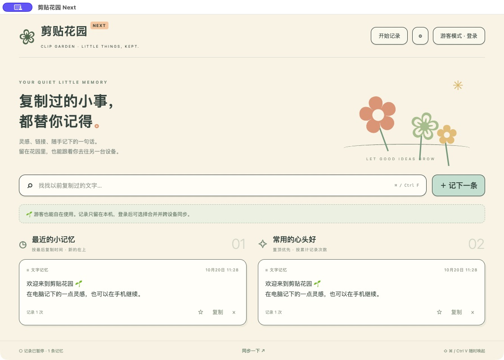

# 剪贴花园 Next

参考本机「剪贴花园」的功能和使用体验，独立实现的跨平台首版。不是从原安装包恢复的源码，不包含原应用代码或素材。



## 当前状态

| 功能 | 状态 |
| --- | --- |
| Windows / macOS 安装应用 | Electron 桌面工程，已生成 macOS ARM64 DMG/ZIP 和 Windows x64 NSIS EXE；macOS 已启动验证，Windows 待真机验证 |
| HarmonyOS 7 | ArkTS / ArkUI 原生工程，API 26.0.0，已编译并签名安装到 Mate 80 Pro Max / 鸿蒙 7；启动和同步仍待真机验收 |
| 登录注册 | 邮箱 + 密码、scrypt 密码哈希、可撤销会话；无需邮件服务即可本机测试 |
| 游客使用 | 不需要服务，本机保存；与账号数据隔离 |
| 游客转账号 | 登录时显式勾选合并，才移动并上传游客记录 |
| 多设备同步 | 同一服务、同一账号；文字、PNG 图片、置顶、删除；断网重试、幂等操作、版本冲突保留副本 |
| 华为账号登录 | 三端共用官方 OAuth 浏览器授权流程，代码和模拟测试已完成；真实登录尚待配置华为应用及回调地址 |
| 鸿蒙系统账号原生一键登录 | 尚未接入 Account Kit 原生授权面板；目前按钮打开系统浏览器，首次需要授权，不能称为原生免跳转一键登录 |

这是可运行的开发首版，不是完成签名、审核和实机验收的正式商用版本。

## 本机直接启动同步服务

安装 **Node.js 24 或更高版本**。服务端完全使用 Node 内置模块，不需要 npm install、Docker 或外部数据库：

```sh
node scripts/local-server.mjs
```

终端会输出本机和局域网地址。本机客户端设置填 `http://127.0.0.1:4318`；其他设备连接同一个局域网，填运行服务电脑的 IPv4 地址，例如 `http://192.168.1.208:4318`。后者随网络可能变化，以终端实际输出为准。需允许电脑防火墙的 4318 端口，电脑关机或服务停止后就无法同步。

1. 打开应用「设置」填写服务地址。
2. 注册一个测试账号，或登录已有测试账号。
3. 另一设备填写同一个服务地址、登录同一个账号。
4. 新增记录后自动轮询同步，也可点击「同步一下」。

局域网 HTTP 没有传输加密，仅用于可信网络开发测试，请不要复用真实密码或复制敏感内容。正式部署使用 HTTPS。数据库默认写入 `data/clipgarden.sqlite`，已从 Git 忽略；支持 `DATABASE_PATH` 指定数据位置。不要把电脑的开发端口直接映射到公网。

仅本机开发、无局域网暴露时：

```sh
node --env-file-if-exists=.env server/index.mjs
```

默认只监听 `127.0.0.1:4318`。环境变量参考 `.env.example`，密钥只放服务端，不写入仓库。

## Windows / macOS 开发与打包

```sh
corepack enable
corepack prepare pnpm@10.28.2 --activate
pnpm install --frozen-lockfile --ignore-scripts
node node_modules/electron/install.js
pnpm start
pnpm test
pnpm dist:mac
pnpm dist:win
```

推荐在对应操作系统打包；GitHub Actions 提供 Windows 和 macOS 构建。产物在 `release/`，不会提交进源码 Git。无生产证书时为未公证 / 未签名测试包，系统可能提示来源验证。

桌面默认暂停记录，用户主动点「开始记录」才启用；不会自动导入启用前的剪贴板。全局快捷键 `Ctrl/Command+Shift+V`，关闭窗口隐藏到托盘，托盘菜单可退出。支持文字和 PNG 图片，忽略已识别的密码管理器敏感标记；不提供完整敏感内容识别。连续重复复制相同内容在轮询 API 中无法可靠计数，频次表示检测到的内容变化 / 手动收录次数，不承诺与系统复制事件数完全一致。

## HarmonyOS 7

使用包含 **API 26** 的 DevEco Studio 打开 `harmony/`，自动安装所需构建工具。SDK 的产品版本配置为 `"26.0.0"`，这是 API 26 新版构建格式。

```sh
hvigorw --mode module -p product=default -p module=entry@default assembleHap
```

使用 DevEco 自带 Node/JBR，或设置 `NODE_HOME`、`JAVA_HOME`、`DEVECO_SDK_HOME` 后调用 DevEco 的 `tools/hvigor/bin/hvigorw`。本机 `local.properties` 从 Git 忽略，勿提交 SDK 绝对路径。

当前产物为 `harmony/entry/build/default/outputs/default/entry-default-unsigned.hap`。在 DevEco 的 Signing Configs 中为 `app.clipgarden.harmony` 配置自己的自动签名或证书后，再安装到已授权设备。不能把其他应用的签名配置直接复用到此包名。已在连接的 Mate 80 Pro Max / 鸿蒙 7 安装本机调试签名版本；启动、交互和跨设备同步仍待验收。本机建立 USB 反向端口后，手机可用 `http://127.0.0.1:4318` 连接电脑服务，拔掉 USB 后需改用同局域网 IP。

鸿蒙端通过系统 `PasteButton` 在用户点击时读取剪贴板，收录文字和 PNG 图片；不会持续在后台读取其他应用的剪贴板。账号令牌保存到系统 Asset Store；记录保存在应用私有 Preferences 沙箱，未单独加密。桌面端数据文件使用 Electron safeStorage 和系统密钥加密。

## 华为账号

见 [华为登录配置](docs/huawei-login.md)。首版使用相同的 Web OAuth 客户端贯通三个系统的身份，避免把不同原生应用的 OpenID 误当作同一身份。

未配置凭据时服务会明确返回 503，不返回虚假登录成功。真实华为授权和鸿蒙原生 Account Kit 一键登录均不能以模拟测试替代验收。

## 同步协议与数据

见 [同步设计](docs/sync.md)。游客、不同账号隔离；登录后账号数据默认开启同步，可在设置关闭。多设备同一记录的离线修改发生冲突时保留服务端版本与本机副本，避免静默覆盖。删除通过 tombstone 同步，旧变更记录的正文被替换，不永久保留历史正文版本；数据库 WAL 和备份仍需运维管理。

服务端 SQLite 不提供端到端加密；管理员可访问内容。每账号最多约 200 MB 当前记录正文；单条文字 2 MB，图片 20 MB / 3000 万像素（客户端限制）。当前适合个人 / 可信小规模测试；公开注册商业服务还需邮件验证、密码找回、账号注销、滥用防护、审计与备份策略。邮箱账号与华为账号不会按未验证邮箱自动合并。

详见 [首版验证记录](docs/verification.md)。

## 仓库内容

- `desktop/`：Electron 主进程、受限 IPC、本机存储、同步客户端。
- `ui/`：桌面界面；`pnpm preview` 可预览样式，不提供浏览器版账号功能。
- `harmony/`：独立 ArkTS / ArkUI 原生客户端。
- `server/`：账号、华为 OAuth、增量同步 API。
- `tests/`：真实 HTTP + SQLite 集成测试和双客户端同步测试。
- `.github/workflows/`：跨系统自动测试 / 打包；产物在 Actions 中下载。

源代码公开存放于 [Trump-One/clip-garden](https://github.com/Trump-One/clip-garden)。未附加开源许可证，公开可见不代表授权任意再分发。
